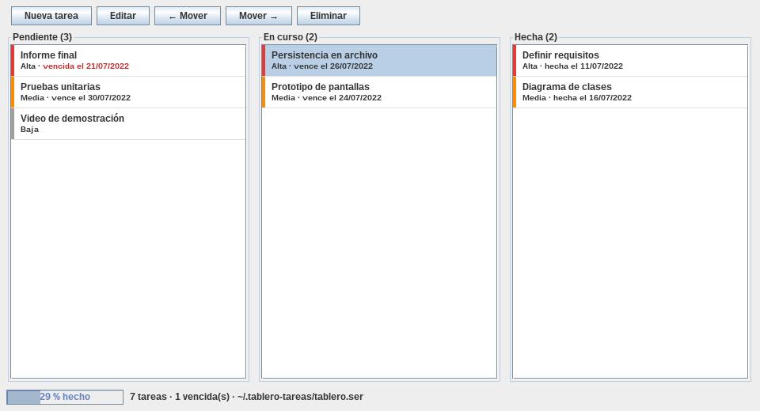

# java-tareas-serializacion

[](https://github.com/Whiteherobot/java-tareas-serializacion/actions/workflows/ci.yml)

Tablero de tareas (estilo kanban) en Java Swing que se guarda con
serialización de objetos. Ejercicio 04.02 de Programación Orientada a Objetos
(julio de 2022), cuyo tema era guardar datos con `ObjectOutputStream` y
`ObjectInputStream`.



- **Tareas**: título, descripción, prioridad y fecha límite opcional. Cada
  columna las ordena por prioridad y luego por fecha límite.
- **Columnas**: *Pendiente*, *En curso* y *Hecha*. Al pasar a *Hecha* se
  registra la fecha y las vencidas se marcan en rojo. La barra inferior muestra
  el avance.
- **Guardado**: cada cambio se guarda solo. Por defecto se usa
  `~/.tablero-tareas/tablero.ser`, o el archivo que se pase como argumento.
  También se puede abrir otro tablero o guardar una copia.

## Cómo se usa la serialización

- **Una sola escritura**: el tablero se guarda entero con un único
  `writeObject`. Las tareas viajan dentro del tablero y al leerlo se recupera el
  grafo de objetos completo, incluido el contador de identificadores.
- **Nunca en modo "agregar"**: abrir el archivo con
  `new FileOutputStream(ruta, true)` crea un `ObjectOutputStream` nuevo, que
  escribe otro encabezado en medio del archivo, y la lectura falla con
  `StreamCorruptedException`. Hay una prueba que reproduce ese error.
- **Escritura segura**: se escribe en un archivo temporal que después reemplaza
  al anterior.
- **`serialVersionUID` explícito** en las clases del modelo.
- **Filtro de deserialización** (`ObjectInputFilter`): solo acepta las clases
  del modelo, la lista que las contiene, los enums y las fechas. Deserializar
  sin filtro un archivo de origen desconocido permite crear objetos arbitrarios,
  que es una vía de ataque conocida. La prueba lo verifica con un archivo que
  contiene otra clase.

## Cómo correrlo

Necesitas JDK 17 o superior. El proyecto trae el wrapper de Maven.

```bash
./mvnw verify                                       # compila y corre las pruebas
java -jar target/tareas-serializacion-1.0.0.jar     # usa ~/.tablero-tareas/tablero.ser
```

## Estructura

```
src/main/java/tareas/
├── modelo/        Tablero, Tarea, Estado y Prioridad (Serializable)
├── persistencia/  ArchivoTablero (guardar, cargar y filtro)
└── vista/         VentanaTareas, PanelTablero, ColumnaTareas y FormularioTarea
```

Las pruebas usan carpetas temporales y corren en GitHub Actions con Java 17 y 21.

## De dónde sale

La entrega de 2022 agregaba serialización al sistema de facturas de los
ejercicios anteriores. Escribía cada registro con un `ObjectOutputStream` nuevo
en modo "agregar" y lo compensaba abriendo un `ObjectInputStream` por objeto.
Además ocultaba los errores, devolvía `null` y guardaba binario en archivos
`.txt`. En 2026 se mantuvo el tema, ahora en un tablero de tareas, donde guardar
un grafo de objetos completo tiene sentido.

## Autor

Michael Lata ([@Whiteherobot](https://github.com/Whiteherobot)). Licencia MIT.
